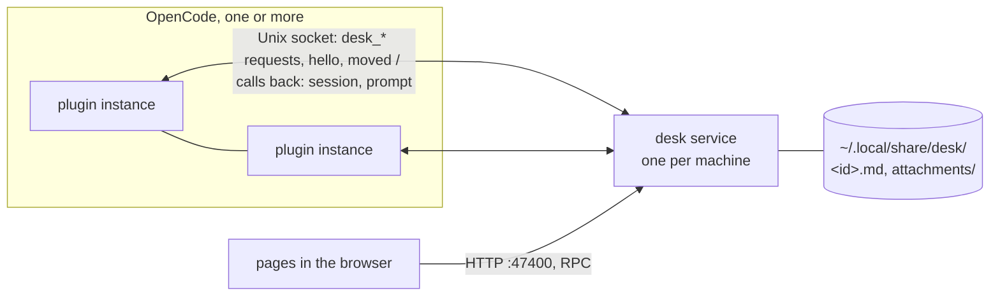

# Desk

Questions, answers and reviews between the user and OpenCode's agents, kept out of the chat. Agents ask with the
`desk_*` tools; the user answers on a page; each answer goes back into the asking session as a message, once.


More stills in [docs/demo/](docs/demo/), made by `bun run demo`.

## Use it

1. `bun install` in this directory (it also builds the page).
2. Link it from the global OpenCode config, `~/.config/opencode/opencode.json(c)`:

   ```jsonc
   { "plugins": ["/Users/<you>/projects/personal/desk"] }
   ```

   Or with options: `{ "package": "/Users/<you>/projects/personal/desk", "options": { "port": 47400, "home": "~/.local/share/desk" } }`.
   Edits here apply when OpenCode reloads its plugins; there's no release step.
3. In a session, `/desk` turns the desk on for it (and its subagents); `/desk` again turns it off. Off by default:
   a session with the desk off doesn't see the `desk_*` tools at all.
4. The page is `http://127.0.0.1:47400/` (or the `url` in `<store>/service.json` if that port was taken). `/desk` and
   every `desk_ask` result link to the session's project there.

## How it fits together



- **The service** (`src/service/main.ts`, Effect on Bun) is the only thing that touches the store. It serves the
  page (port 47400 when free, else any free port), answers the plugins on `<store>/desk.sock`, and delivers answers.
  One per store: it registers itself in `<store>/service.json` (`{ pid, protocol, url, socket }`), created exclusively,
  like OpenCode's own `service.json`; a second service finds a live registration and exits, a dead one's is replaced.
  On `hello`, a plugin newer than the service (`protocol` in `src/protocol.ts`) makes it retire and starts the new one;
  an older plugin is told to `/reload`. It exits
  10 minutes after its last client (plugin connection or open page) goes.
- **A plugin instance** (`src/plugin/`, an Effect plugin: `@opencode/plugin/effect`) is a thin, stateless client. When
  it loads it connects to the socket, starting the service detached if nobody answers (log: `<store>/service.log`),
  says `hello`, and holds the connection, reconnecting (and restarting the service) if it drops. It is also the
  service's only way into OpenCode: on that connection the service asks it to look sessions up and to prompt them, and
  it reports `session.moved`. So the service needs no OpenCode endpoint or password.
- **Delivery**: the user's text is written to its entries as an outbox (an OpenCode message id, fixed up front), then
  sent with `session.prompt({ id })` through a connected plugin instance whose OpenCode knows the session. OpenCode admits a message id
  once, so retries can't duplicate. With no such OpenCode connected, the entry stays "answered, not delivered" (a
  pill on the page; `outbox:` in its file) and goes out when one connects.
- **Projects**: entries store their root session and directory, not a project. The service asks OpenCode for the
  root session's `projectID` (through a plugin) and remembers it in memory only. A session is asked again when it
  moves, and every session when a plugin connects (catching moves missed meanwhile); while OpenCode is away, what was
  known stays. A session no connected OpenCode knows goes under its folder, marked as a guess. The page's header says
  whether OpenCode is connected. The page shows one project at a time (`/projects/<id>`, an entry at
  `/projects/<id>/questions/<entry id>`); `/` lists the projects.

| Module | What it is |
|---|---|
| `src/entry.ts` | the entry, its file format, whose turn it is, the desk's order |
| `src/store.ts` | the flat directory: the desk's only state, read fresh every time; writes land whole (temp file + rename) |
| `src/desk.ts` | the rules: ask, answer, adopt, prioritize, resolve, reply (into the outbox); one change at a time, each reading the files first |
| `src/outbox.ts` | outbox entries → the messages to send |
| `src/delivery.ts` | sends outbox messages, retrying on reconnect and every 30 s |
| `src/opencode.ts` | OpenCode as the service reaches it: the connected plugin instances (`Client`) |
| `src/projects.ts` | entry → project, cached |
| `src/service/` | `api.ts` (what each request does), `socket.ts`, `http.ts`, `clients.ts` (idle exit), `app.ts` (assembly), `main.ts` |
| `src/plugin/` | `index.ts` (`/desk`, tools, hiding them), `connection.ts` (connect or start the service) |
| `src/protocol.ts`, `src/page-api.ts` | the socket's and the page's contracts |
| `page/` | the page (Solid, built by Vite into `page/dist/`); Mermaid renders in the browser, loaded on first use |

## Entries

One Markdown file per entry, `<store>/<id>.md`, ids random UUIDs never reused. Other files in the store aren't entries.

```md
---
parent: 3f2b8c1e-6b1e-4c2a-9d4e-1f2a3b4c5d6e
asker: agent
status: answered
session: ses_…
directory: "/Users/me/projects/phantom"
labels: [design, icons]
priority: high
created: "2026-11-07T16:30:00.000Z"
outbox: msg_…
delivery: queue
---

# Which icon?

The question.

<!-- desk:answer -->

The answer.
```

- **Asker and answerer:** `asker` is `agent` or `user`; the answerer is the other one.
- **Status:** `open` (waiting on the answerer) → `answered` (waiting on the asker) → `resolved` (the asker marked it done; refused while anything below it is unresolved, or while the user's text on it is undelivered). A resolved entry with no follow-ups leaves the desk, then its parent gets the same check, up the chain; attachments only they referenced go too.
- **Blocked:** an unresolved entry with anything unresolved below it waits on nobody; its follow-ups carry the wait.
- **Session and directory:** the top-level session the entry belongs to (a subagent's question goes to the session above it) and where it works. Relative paths in the entry's Markdown resolve against the directory (`/files/<id>/<path>` on the page).
- **Outbox and delivery:** present only while the user's text hasn't reached the session. Entries sharing an outbox go out as one message (one per session per Submit).
- **Parents:** set once, never changed; a top-level entry may be adopted once (`desk_adopt`), never into its own subtree.
- **PR questions:** `desk_ask` with a `pr:<n>` label and no `parent` files the entry under the newest unresolved top-level `review` + `pr:<n>` entry of the same project.
- **Priority:** `critical`, `high`, `normal` (absent), `low`. Follow-ups inherit their parent's unless given one.
- **Order:** priority, then each tree post-order (follow-ups before what they hang under), trees by `created`.

The page works as Phantom's did: *Waiting on you* / *Waiting on the agents* / *Resolved*, drafts kept in the browser
(with attachments in IndexedDB), **Send & next** (⌘↵), **Next** (⇧⌘↵), **Send now** (steers the session), **Submit**
(every draft, queued). Attachments are stored as `<store>/attachments/<uuid>.<ext>`, linked as `/attachments/…`, and
passed to the session as files.

## Develop

```sh
bun install
bun run test        # builds the page, then all tests (a bare `bun test` uses whatever page/dist/ holds)
bunx tsc --noEmit
bun run page        # rebuild the page on save
bun run demo        # docs/demo/: stills and the GIF (needs Google Chrome and ffmpeg)
```

Tests never touch the real store or port: the service runs in-process on a temp store, port 0 and fake OpenCode
instances behind fake plugin connections (`tests/support/`); the plugin test starts a real service process on a temp store. To run a service by hand,
set `DESK_HOME` (store), `DESK_PORT` and optionally `DESK_IDLE` (ms): `DESK_HOME=$(mktemp -d) DESK_PORT=47401 bun run service`.
