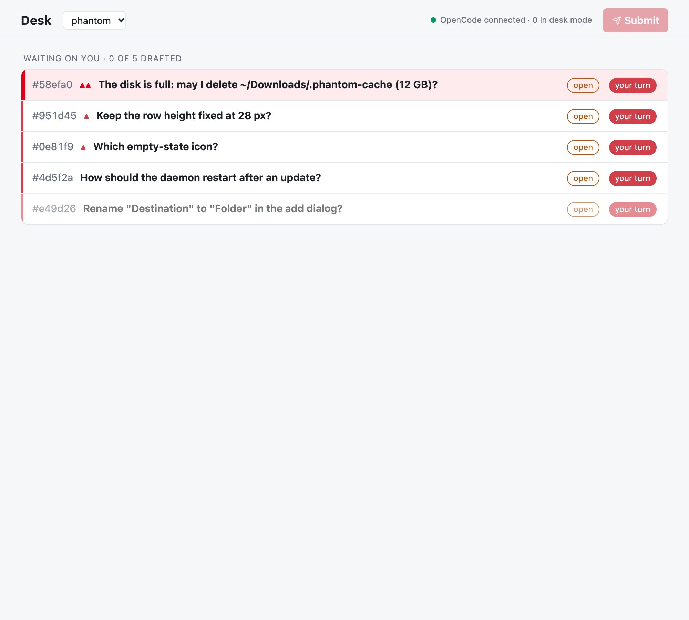
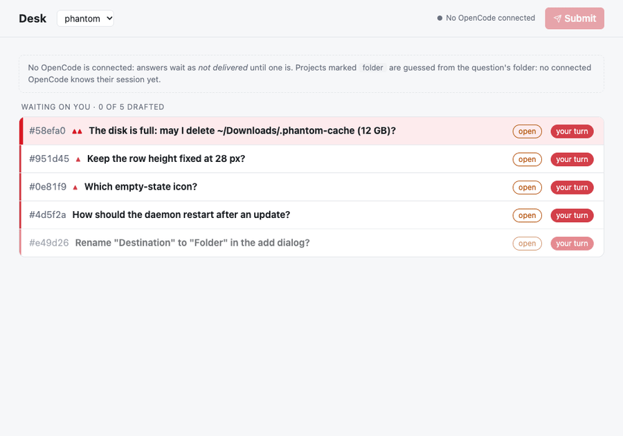
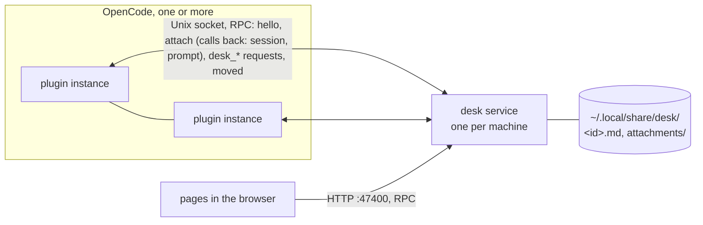

# Desk

Questions, answers and reviews between the user and OpenCode's agents, kept out of the chat. Agents ask with the
`desk_*` tools; the user answers on a page; each answer goes back into the asking session as a message, once.

## Why

In a chat, questions and answers stop lining up as soon as there's more than one. The agent asks three things. You
answer two straight away; the third needs a look at the code, so you start a subagent on it. Meanwhile the agent asks
something new, a subagent asks something of its own, and a review comes in. Every answer is a chat message, the
questions have scrolled away, and nobody can tell any more which answer belongs to which question, which ones are
still open, or whose turn it is. The longer the session and the more sessions run at once, the more gets lost.

The desk gives every question its own entry: a title, the full question, its status (open, answered, resolved),
whose turn it is, and the thread it belongs to. You answer them on one page, in any order, as drafts sent together
or one at a time; each answer reaches the asking session tagged with the question it answers. Agents ask there
instead of in chat, and refer to an entry by its title.





More stills in [docs/demo/](docs/demo/), made by `bun run demo`.

## Use it

1. `bun install` in this directory (it also builds the page).
2. Link it from the global OpenCode config, `~/.config/opencode/opencode.json(c)`:

   ```jsonc
   { "plugins": ["/Users/<you>/projects/personal/desk"] }
   ```

   Or with options: `{ "package": "/Users/<you>/projects/personal/desk", "options": { "port": 47400, "home": "~/.local/share/desk" } }`.
   Each option can be set in the environment instead, as `DESK_` and its name (`DESK_HOME`, `DESK_PORT`, `DESK_TIMEOUT`); the options win.
   Edits here apply when OpenCode reloads its plugins; there's no release step.
3. In a session, `/desk-mode` turns desk mode on for it (and its subagents); `/desk-mode` again turns it off. Off by
   default: a session without it doesn't see the `desk_*` tools at all. With it on, agents are told to put every
   question for the user on the desk, not in chat.
4. The page is `http://127.0.0.1:47400/` (or the `url` in `<store>/service.json` if that port was taken);
   `/desk-mode` links to the session's desk there. In a session with desk mode on, the TUI's footer shows `desk`, or
   `desk [N]` when N entries of the session's desk wait on you (`[N !M]`, M in red, for critical ones); clicking it
   opens the page. The badge is the plugin's `./tui`
   part, so it loads wherever the plugin does.

## How it fits together



- **The service** (`src/service/main.ts`, Effect on Bun) is the only thing that touches the store. It serves the
  page (port 47400 when free, else any free port), answers the plugins on `<store>/desk.sock`, and delivers answers.
  One per store: it registers itself in `<store>/service.json` (`{ pid, protocol, url, socket }`, `src/shared/service-info.ts`),
  created exclusively, like OpenCode's own `service.json`. That's the only lock: a second service finds a live
  registration and exits, a dead one's is replaced.
  The socket carries an `effect/rpc` group, `PluginApi` (`src/api/protocol.ts`), checked on both sides; what the desk
  refuses comes back typed and is worded by the plugin or the page (`src/model/wording.ts`). Its version is a hash of the
  contract's code (`protocol.ts`, `entry.ts`, `errors.ts`, `bun.lock`), so nothing is bumped by hand. On `hello` with
  another version, a service whose contract on disk changed since it loaded retires (the plugin starts the new one);
  otherwise the plugin is told to `/reload`. So a contract change restarts the service by itself (the plugin reloads
  and says `hello`); after a change to the service's own code, restart it (`kill` the pid in `service.json`). It exits 10 minutes after its last client
  (plugin connection or open page) goes, or on a signal, within about a second even with pages open.
- **A plugin instance** (`src/plugin/`, an Effect plugin: `@opencode/plugin/effect`) is a thin, stateless client, one per
  directory OpenCode works in. While a session in its directory is in desk mode, it connects to the socket, starting
  the service detached if nobody answers (log: `<store>/service.log`), says `hello`, and holds `attach` open with those
  sessions (later changes as `modes`); it hangs up when the last one turns desk mode off. Connected, it reconnects
  (restarting the service) if the connection drops. It is also the service's only way into OpenCode: the service's
  calls (look a session up, prompt one) come on the `attach` stream and the plugin answers each with `reply`; the
  attachment lasts exactly as long as the stream. It reports `session.moved`. So the service needs no OpenCode endpoint or password.
- **Delivery**: the user's text is written to its entries as an outbox (an OpenCode message id, fixed up front), then
  sent with `session.prompt({ id })` through a connected plugin instance whose OpenCode knows the session. OpenCode admits a message id
  once, so retries can't duplicate. With no such OpenCode connected, the entry stays "answered, not delivered" (a
  pill on the page; `outbox:` in its file) and goes out when one connects.
- **Desks**: each top-level session has its own desk; its subagents ask on it too, and it stays the session's through
  moves and worktree changes. Entries store their top-level session, so a desk is simply that session's entries. A
  thread stays on one desk: a `parent` on another session's desk is refused. A desk is named after its session's title
  and folder ("Phantom · phantom-p5"), asked of OpenCode through a plugin and remembered in memory only; asked again
  when the session moves and when a plugin connects. A session no connected OpenCode knows shows as _unknown session_,
  named after its entries' folder; another session can take its desk over with `desk_claim` (refused while that
  session is in desk mode). The page's header says how many sessions are in desk mode. An answer for a session whose
  OpenCode has nothing in desk mode waits until something is. The page shows one desk at a time (`/sessions/<id>`, an
  entry at `/sessions/<id>/questions/<entry id>`); `/` lists the desks.

| Directory                | What it is                                                                                                                                                                                                                                                                                                                                                                                                |
| ------------------------ | --------------------------------------------------------------------------------------------------------------------------------------------------------------------------------------------------------------------------------------------------------------------------------------------------------------------------------------------------------------------------------------------------------- |
| `src/model/`             | the entry and its rules, shared by every side: `entry.ts` (the entry, its file format, whose turn it is, the desk's order), `lifecycle.ts` (what can happen to one entry: a pure `reconcile(entry, event)`, the entry after or why it's refused), `errors.ts` (the refusals), `wording.ts` (how clients word them)                                                                                        |
| `src/api/`               | the contracts: `protocol.ts` (the plugins' RPC group, versioned by a hash of the contract's code), `page-api.ts` (the page's), `routes.ts` (the page's paths: `/sessions/<id>`, its entries, `/rpc`)                                                                                                                                                                                                      |
| `src/service/`           | the service: `main.ts`, `app.ts` (its layers), `desk.ts` (the rules: ask, answer, adopt, prioritize, resolve, reply into the outbox; each change one transaction), `clients.ts` (idle exit; a machine)                                                                                                                                                                                                    |
| `src/service/storage/`   | the store, the only part of the service that touches it: `storage.ts` (`Storage`: the entries, one transaction at a time, when to read again, attachments, files of an entry's directory), `files.ts` (on disk: the flat directory, the desk's only state, read fresh every time; writes land whole), `memory.ts` (in memory, for tests), `registration.ts` (`service.json`, the store's lock; a machine) |
| `src/service/delivery/`  | `outbox.ts` (outbox entries → the messages to send), `delivery.ts` (sends them, one machine per due message, retrying on reconnect and every 30 s)                                                                                                                                                                                                                                                        |
| `src/service/opencode/`  | OpenCode as the service reaches it: `opencode.ts` (the connected plugin instances), `sessions.ts` (a desk's name: its session's title and folder, cached)                                                                                                                                                                                                                                                 |
| `src/service/transport/` | `api.ts` (what each request does), `socket.ts` (the plugins), `http.ts` (the page and its RPC)                                                                                                                                                                                                                                                                                                            |
| `src/plugin/`            | `index.ts` (the assembly), `modes.ts` (desk mode in storage, the connection following it), `command.ts` (`/desk-mode`), `tools.ts` (the tools, hiding them), `sessions.ts` (OpenCode's sessions), `calls.ts` (the service, within the timeout), `connection.ts` (connect or start the service; a machine)                                                                                                 |
| `src/tui/`               | `index.tsx` (the TUI's footer badge: which desk a session reports), `badge.ts` (its data: the registered service's list of desks, through restarts)                                                                                                                                                                                                                                                       |
| `src/shared/`            | `machine.ts` (state machines as actors: a pure `reconcile(state, event) → state`, and what each state runs while it lasts), `settings.ts` (the settings as Effect `Config`: the plugin's options, then `DESK_<NAME>`, then the defaults), `service-info.ts` (a store's service files and the registration's reader), `empty.ts`                                                                           |
| `page/`                  | the page (Solid, built by Vite into `page/dist/`); Mermaid renders in the browser, loaded on first use                                                                                                                                                                                                                                                                                                    |

## Entries

One Markdown file per entry, `<store>/<id>.md`, ids random UUIDs never reused. Other files in the store aren't entries.

```md
---

parent: 3f2b8c1e-6b1e-4c2a-9d4e-1f2a3b4c5d6e
asker: agent
status: answered
session: ses_…
directory: "/Users/me/projects/phantom"
labels: [design, icons]
priority: high
created: "2026-11-07T16:30:00.000Z"
outbox: msg_…
delivery: queue
---

# Which icon?

The question.

<!-- desk:answer -->

The answer.
```

- **Asker and answerer:** `asker` is `agent` or `user`; the answerer is the other one.
- **Status:** `open` (waiting on the answerer) → `answered` (waiting on the asker) → `resolved` (the asker marked it done; refused while anything below it is unresolved, or while the user's text on it is undelivered). A resolved entry with no follow-ups leaves the desk, then its parent gets the same check, up the chain; attachments only they referenced go too.
- **Session and directory:** the top-level session the entry belongs to (a subagent's question goes to the session above it) and where it works. Relative paths in the entry's Markdown resolve against the directory (`/files/<id>/<path>` on the page).
- **Outbox and delivery:** present only while the user's text hasn't reached the session. Entries sharing an outbox go out as one message (one per session per Submit).
- **Parents:** set once, never changed, and on the same desk; a top-level entry may be adopted once (`desk_adopt`), never into its own subtree.
- **PR questions:** `desk_ask` with a `pr:<n>` label and no `parent` files the entry under the newest unresolved top-level `review` + `pr:<n>` entry on the asker's desk.
- **Priority:** `critical`, `high`, `normal` (absent), `low`. Follow-ups inherit their parent's unless given one.
- **Order:** priority, then each tree post-order (follow-ups before what they hang under), trees by `created`.

The page works as Phantom's did: _Waiting on you_ / _Waiting on the agents_ / _Resolved_, drafts kept in the browser
(with attachments in IndexedDB), **Send & next** (⌘↵), **Next** (⇧⌘↵), **Send now** (steers the session), **Submit**
(every draft, queued). Attachments are stored as `<store>/attachments/<uuid>.<ext>`, linked as `/attachments/…`, and
passed to the session as files.

## Develop

```sh
bun install
bun run test        # builds the page, then all tests (a bare `bun test` uses whatever page/dist/ holds)
bunx tsc --noEmit
bun run lint        # Biome: lint, formatting, import order (`bun run format` applies them)
bun run page        # rebuild the page on save
bun run demo        # docs/demo/: stills and the GIF (needs Google Chrome and ffmpeg)
```

Tests never touch the real store or port: the desk's rules run on memory storage (`Storage.layerMemory`); the service runs in-process on a temp store, port 0 and fake OpenCode
instances behind fake plugin connections (`tests/support/`); the plugin test starts a real service process on a temp store. To run a service by hand,
set `DESK_HOME` (store), `DESK_PORT` and optionally `DESK_IDLE` (a duration such as `"1 minute"`, or ms): `DESK_HOME=$(mktemp -d) DESK_PORT=47401 bun run service`.
